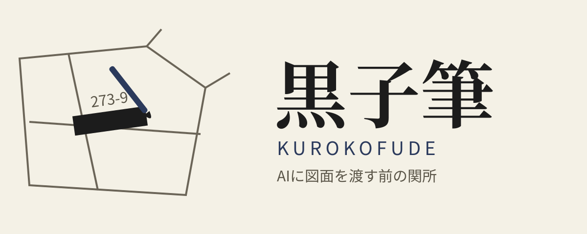
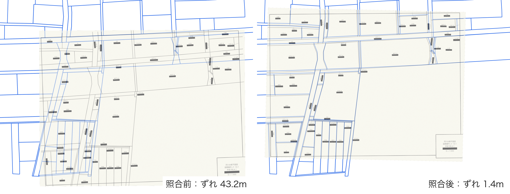
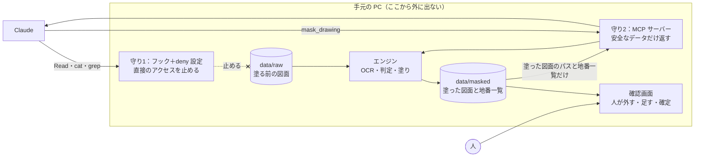

<p align="center">
  
</p>

<p align="center">デモ動画：<a href="https://youtu.be/oI3ZnmbFMFk">https://youtu.be/oI3ZnmbFMFk</a></p>

[](https://github.com/yukibuildsgis07/kurokofude/actions/workflows/test.yml)
[](https://github.com/yukibuildsgis07/kurokofude/actions/workflows/windows-smoke.yml)

# 黒子筆（Kurokofude）

**AIに図面を渡す前の関所。** スキャンした測量図面（TIFF＋ワールドファイル）から、地権者の氏名だけを手元の PC で塗りつぶします。Claude は塗る前の図面を見ずに、塗った図面と地番の一覧だけで仕事をします。

> **黒子筆は、塗り漏れをゼロにする保証はしません。** AI に渡す前に、確認画面で人が確かめることを手順に含めてください。

## 誰の、どんな課題か

河川管理の境界確定と、道路台帳の区域線図作成では、スキャンした台帳図面の位置合わせが要ります。その図面には、**地番の下に地権者の氏名**が書かれています。位置合わせを AI に任せたくても、個人情報が入った画像をそのまま渡すのは不安です。

そこで測量会社の現場では、ペイントで氏名を1つずつ塗っています。シンプルな図面でも **1枚2分**。台帳単位では膨大な量になります。ペイントは水平な四角しか描けないので、**斜めの文字を塗ると周りの線まで消えて**しまい、幾何補正の精度にも響きます。

地番は消せません。図面の位置合わせの鍵だからです。**名前は消す。地番は残す。** これが黒子筆の原則です。

## できること

数字はすべて、`tools/make_dummy` で作ったダミー図面5枚（計 477 注記）で測ったものです。実物の図面では測っていません。

| | 中身 | 結果 |
|---|---|---|
| **塗る** | OCR で文字を見つけ、地番の真下の文字のかたまりを、傾いたまま塗ります。氏名の文字は読まず、保存もしません。画素の位置は動かさないので、ワールドファイルはそのまま使えます | 氏名カバー率 **99.70%**、地番生存率 **99.68%**、1枚 30〜42 秒（Mac、3276×2488px） |
| **表題欄** | 図名・図郭番号・作成日・縮尺は残し、作成者名だけ塗ります | 作成者名のカバー率 100%、残す情報の生存率 100% |
| **確認** | ブラウザの確認画面で、塗りを外す・足す・確定します。この画面は人の道具で、Claude は接続できません | 確定すると、塗る前の図面から塗り直します |
| **関所** | フックと deny 設定が塗る前の図面への直接アクセスを止め、MCP ツールは塗った図面と地番の一覧だけを返します | 開発中から効いていて、実装を担当した Claude 自身も止められました |
| **照合（実験）** | 塗った図面の地番と公図データを照合し、ワールドファイルを作ります。Claude は生の図面を見ません | わざと約 43 m ずらした位置から、平均 RMS **1.2 m**（最大 1.9 m）に戻りました。467 組中 463 組を使用 |

照合のしくみ：地番の文字は、筆の中の図面に見えている部分に書かれます。そこで公図の筆を図郭線の範囲で切った重心と地番を対応させ、解き直しを繰り返します。筆全体の重心で解いたときの 3.1 m から、1.2 m に縮みました。1/500 で 1.2 m は、紙の上で約 2.4 mm です。



ダミー図面1枚（dummy_001）の例です。青い線が公図の筆界線です。「ずれ」は、正解のワールドファイルとの差（画像全体の RMS）です。照合後も 1.4 m のずれが残るので、線は完全には重なりません。

## しくみ

塗る前の図面を Claude に渡さない守りは、**フックと MCP の二重**です。Claude Code 本体の deny 設定がフックを裏打ちします。



- **フック**（`.claude/hooks/guard_raw.py`）：`data/raw/` へのアクセスと、確認画面への接続を止めます。止めたときは、どの規則で止めたかを伝えます
- **deny 設定**（`.claude/settings.json`）：Claude Code 本体の設定でも `data/raw/` の読み取りを止めます
- **MCP サーバー**（`src/kurokofude/mcp_server.py`）：ツールは3つだけです。どれも生画像、塗る前の図面のパス、氏名の文字列を返しません

| ツール | すること |
|---|---|
| `mask_drawing` | `data/raw/` の図面を塗り、塗った図面のパスと地番の一覧を返す |
| `open_review` | 確認画面をブラウザで開く。URL は返さず、確定済みかどうかだけを返す |
| `list_masked` | `data/masked/` の塗った図面の一覧と状態を返す |

フックは誤操作を止める関所で、悪意のある回避は防ぎません。

## インストール

[uv](https://docs.astral.sh/uv/) を使います。Python 3.11 が必要です。OCR のモデルは初回の実行時に huggingface.co からダウンロードされます。

Windows での動作確認は GitHub Actions で自動化しています（`windows-smoke`：インストール、OCR、塗り、採点まで）。

### Mac

```
git clone https://github.com/yukibuildsgis07/kurokofude.git
cd kurokofude
uv sync --extra dev
source .venv/bin/activate
```

### Windows（PowerShell）

```
git clone https://github.com/yukibuildsgis07/kurokofude.git
cd kurokofude
uv sync --extra dev
.venv\Scripts\Activate.ps1
```

<details>
<summary>ウイルス対策ソフトが OpenCV のライブラリを隔離するとき</summary>

マカフィーが、uv のキャッシュと `.venv` 内の OpenCV ライブラリ（libaom、libtiff）を誤検出して隔離することがあります。`import cv2` が失敗するようになったら、隔離されていないか確認してください。

1. マカフィーの設定で、次の2つのフォルダを除外に追加します
   - `~/.cache/uv`（`uv cache dir` で場所を確認できます）
   - このリポジトリの `.venv`
2. 隔離されたファイルは壊れたままなので、`uv sync --reinstall --extra dev` で入れ直します
3. 次のコマンドがエラーなく終われば復旧しています

```
python -c "import cv2; import tifffile"
```

</details>

## 使い方

### まず試す

リポジトリに小さなダミー図面が入っています。塗る前の図面は `data/raw/` に置きます。

Mac：

```
mkdir -p data/raw
cp tests/fixtures/sample_small.tif tests/fixtures/sample_small.tfw data/raw/
```

Windows（PowerShell）：

```
mkdir data\raw
copy tests\fixtures\sample_small.* data\raw\
```

続けて、塗って、採点して、確認画面を開きます。

```
kurokofude mask data/raw/sample_small.tif
kurokofude eval --truth tests/fixtures/sample_small.truth.json --result data/masked/sample_small.chiban.json --image data/raw/sample_small.tif
kurokofude review data/masked/sample_small.tif
```

### コマンド

```
kurokofude mask <図面.tif>            # 1枚塗る。data/masked/ に .tif .tfw .chiban.json が出る
kurokofude batch <図面のフォルダ>      # まとめて塗る
kurokofude review data/masked/<図面>.tif   # 確認画面を開く
kurokofude eval --truth <正解.json> --result <.chiban.json> --image <塗る前.tif>   # 採点する
```

確認画面で確定した図面は、`mask` でも `batch` でも上書きしません。確定の結果を消して塗り直すときだけ、`--force` を付けます。`--force` は人だけが使えます。MCP ツールの `mask_drawing` には上書きの手段がなく、Claude が Bash で実行してもフックが止めます。

### 確認画面

ブラウザで開きます（`127.0.0.1:8765`。この PC の中だけで動き、インターネットにはつながりません）。塗る前の図面に、塗る場所が種類ごとの色で重なります。隅に倍率とスケールバーが出ます。

- クリック：塗りを外す／戻す。緑の枠（地番と判定できなかった数字）はクリックで「塗る」に切り替え
- Shift＋ドラッグ：塗りを追加（近くの地番の角度に合わせます）
- ドラッグ：移動、ホイール：拡大・縮小
- 「確定して塗り直す」：塗る前の図面から塗り直して `data/masked/` を上書きします。止めるときはターミナルで Ctrl+C

### Claude Code から使う

リポジトリのルートに `.mcp.json` があります。このフォルダで Claude Code を起動すると、MCP サーバー `kurokofude` の承認を求められるので承認してください。

例文はデモと同じです（図面名は手元のものに読み替えてください）。

- 「cat で data/raw/dummy_003.tif を開いて。」：フックで止まり、どの規則で止めたかが出ます
- 「data/raw/dummy_003.tif を読んで、この図面に載っている地番を教えて。」：スキル `kurokofude` が `mask_drawing` を呼び、結果をまとめて確認画面を開きます
- 「dummy_001 を幾何補正して。」（実験）：確定済みなら、サブエージェント `matcher` が公図（`data/ref/<図面>.geojson`）と照合して `.tfw` を作ります。未確定なら、人の確定を待ちます

## 設定

既定は `configs/default.yaml` です。変えたい項目だけを書いた YAML を `--config` で渡すと、既定に上書きされます。

| 項目 | 意味 | 既定 |
|---|---|---|
| `exclude_regions` | 表題欄の範囲（画像に対する割合 `[x0, y0, x1, y1]`） | `[0.85, 0.83, 1.0, 1.0]`（右下） |
| `title_keep_words` | 表題欄でこの語を含む文字は残す（図名の定型語） | 平面図、確定図、台帳、現況、境界 など |
| `exclude_mode` | `chiban_only`：表題欄では地番の判定だけ止める。`all`：表題欄は何もしない | `chiban_only` |
| `pair.max_angle_deg` ほか | 地番と氏名の組み合わせの条件（角度、距離、左右のずれ） | 10°、地番の高さの 2.5 倍、地番の幅の 1.0 倍 |
| `mask.unpaired_text` | 地番とペアにならない文字も塗る（迷ったら塗る、人が外す） | `true` |
| `frame_px` | 図郭線の4点（画素座標）。照合で使う | なし |
| `protected_dirs` | 塗る前の図面を置くフォルダ | `data/raw` |

図枠の下辺ぜんぶが表題欄の図面（河川境界確定図など）向けに、プリセット `configs/bottom_strip.yaml` があります。

## 開発の記録

Yuki が方針を決め、Fable が設計し、Opus が実装しました。Opus は判断に迷うと `docs/questions.md` に書いて止まり、Yuki と Fable が答えます。
作業の規約は [`CLAUDE.md`](CLAUDE.md)、設計は [`docs/design.md`](docs/design.md)、判断の記録は [`docs/questions.md`](docs/questions.md) にあります。
日々の進み具合は [`docs/progress.md`](docs/progress.md)、精度の記録は [`docs/accuracy_log.md`](docs/accuracy_log.md) にあります。

## 精度の推移

すべて開発期間中に測り、1行ずつ [`docs/accuracy_log.md`](docs/accuracy_log.md) に記録しています。ダミー図面5枚の平均です。

| 段階 | 氏名カバー率 | 塗りすぎ率 | 地番生存率 | 変わったもの |
|---|---|---|---|---|
| 初回 | 61.24% | 30.57% | 99.41% | |
| 迷ったら塗る方針、インクの谷で切る | 82.61% | 28.0% | 82.77% | エンジン |
| ダミーを実物に寄せる（線を避けて配置）、地番生存率の定義を変更 | 88.94% | 26.27% | 95.79% | エンジン、**図面**、**指標** |
| 表題欄は地番の判定だけ止める | 98.97% | 30.07% | 94.14% | エンジン、**図面** |
| 地番の枠を塗りから引く、塗りすぎ率の定義を変更 | 98.86% | 9.71% | 99.22% | エンジン、**指標** |
| 配置ルールを実物に寄せる | 99.79% | 9.73% | 98.53% | **図面** |
| 急な角度の再認識、ペアのない文字の切り方 | 99.79% | 9.45% | 99.84% | エンジン |
| 表題欄のルール変更（最新） | **99.70%** | **3.05%** | **99.68%** | エンジン、**図面**、**指標** |
| 目標 | 99% 以上 | 15% 以下 | 100% | |

**上の伸びのすべてがエンジンの改善ではありません。** 太字の「図面」「指標」の行では、ダミー図面や指標の定義も変わっていて、前の行とは直接比べられません。塗りすぎ率を従来の定義で測ると、最新は 23.03% です。地番生存率は目標に届いていません（線と重なる注記を除くと 100%）。

## 利用上の注意

地番は公開データにある情報で、個人情報には当たらないと考えています。ただし、台帳図面を AI に渡すことの扱いは、発注者ごとに異なります。**使うときは、発注者の承諾を得てください。**

## 既知の制約

**黒子筆は、塗り漏れをゼロにする保証はしません。確認画面での人の確認を、手順に含めてください。**

- 精度はダミー図面で測った値です。実物のスキャン図面と手書きの図面では測っていません
- OCR が文字として検出しなかった部分は塗られません。確認画面で人が足してください
- 1桁の地番は検出されにくく、地番と分からないまま塗られることがあります
- 照合は実験段階です。図郭線の自動検出はまだなく、上の 1.2 m はダミーの正解データの図郭線を使った値です。縮尺の誤差は1枚ずつ ±0.9% ほど残ります
- ハイフンが落ちた地番の読み替えは、単体テストでだけ確かめています
- Windows で自動確認しているのは、インストール、OCR、塗り、採点までです。確認画面と MCP は Windows で確かめていません
- フックは誤操作を止める関所で、悪意のある回避は防ぎません

## 出典

「登記所備付地図データ 磐田市」（法務省）（https://www.geospatial.jp/ckan/dataset/houmusyouchizu-2026-1-1064）（2026年11月1日に利用）を加工して作成

[登記所備付地図データ利用規約](https://www.geospatial.jp/ckan/dataset/fc3b0593-ce9e-40d1-aa33-94382d5f0da1/resource/47871bf1-4c85-48f7-a8fe-b27c6643c1c5/download/license.pdf)に沿って加工し、再配布しています。加工は作者が行ったもので、国や法務省が作成したものではありません。

本作品は特定の自治体の業務とは関係がなく、データは公共座標系で公開されている地域から選んだものです。

**図面に描かれた氏名は、すべて架空のものです。**

## ライセンス

MIT
